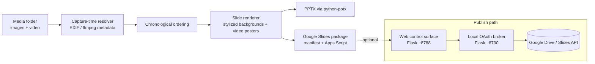

# capture-time-deck-builder

Turns a folder of photos and videos into a chronologically ordered slide deck (PPTX or Google Slides), for anyone who wants an event or trip recap built automatically instead of by hand.

```text
$ python scripts/make_sample_media.py        # 10 synthetic images, out-of-order capture times
$ python scripts/build_presentation.py --input sample_media
Praesentation erstellt: output/all_images.pptx
{ "image_slides": 10, "video_poster_slides": 0, "media_items": 10 }
```

## Why

Assembling a deck from a large, mixed media folder is tedious: files arrive out of order, mix portrait and landscape, and include videos that need a poster frame. This tool resolves each item's real capture time, orders everything oldest to newest, renders consistent slides, and can publish straight to Google Slides through a small local OAuth broker.

## Architecture



- `scripts/build_presentation.py`: the core offline pipeline. Walks an input folder recursively, resolves capture time, orders items, renders slides, and writes a PPTX or a Google Slides import package.
- `webapp/app.py`: a Flask control surface that drives the pipeline against media stored in Google Drive and publishes the result as a Google Slides deck, with resumable run state.
- `auth-hub/server.py`: a local OAuth broker that handles the Google Drive and Slides consent flow and hands short-lived tokens to the web app. Multiple mini-apps register in `auth-hub/apps.json`.

## Key decisions and trade-offs

- **Capture time over filename or upload order.** Images use EXIF (`DateTimeOriginal`, falling back to `DateTime`), videos use ffmpeg container metadata, and anything without metadata falls back to file mtime. This keeps ordering correct across devices, at the cost of depending on metadata quality.
- **Local OAuth broker as a separate service.** Auth is isolated from the app so the Google consent flow and token storage live in one place and can be reused by other small apps. The trade-off is a second process to run.
- **Deterministic ordering, no semantic grouping.** Ordering is purely chronological. There is no ML scene or face grouping, which keeps the output predictable and dependency-light but means no content-aware clustering.
- **Stylized full-bleed backgrounds.** Portrait and low-resolution images are placed on a blurred, side-extended background so a mixed set still looks consistent on 16:9 slides.
- **Resumable runs.** The web pipeline checkpoints run state so a long publish job can resume after a transient network error instead of restarting.

## Verification

The pipeline emits a run report (`write_run_report`) with per-slide counts and a coverage audit (`build_coverage_report`) that lists `missing`, `duplicate`, and `unused` media against the expected set, so a run can be checked for completeness rather than trusted blindly.

## Run locally

Offline PPTX from synthetic sample media (no Google account needed):

```bash
python3 -m venv .venv && source .venv/bin/activate
pip install -r requirements.txt
python scripts/make_sample_media.py            # writes ./sample_media (10 placeholder images with EXIF times)
python scripts/build_presentation.py --input sample_media
# -> output/all_images.pptx, ordered by capture time
```

Publish path to Google Slides (optional):

```bash
cp .env.example .env
# place a Google OAuth desktop-client JSON at auth-hub/credentials.json
python auth-hub/server.py    # terminal 1, port 8790
python webapp/app.py         # terminal 2, port 8788, then open http://127.0.0.1:8788
```

## Limitations and next steps

- No content-aware grouping; ordering is time-only.
- Video embedding depends on ffmpeg (bundled via `imageio-ffmpeg`) and on Google Slides video support.
- The web app targets Google Drive and Slides specifically; other storage or export targets would need new adapters.
- The sample media is synthetic; point `--input` at your own folder for real decks.
